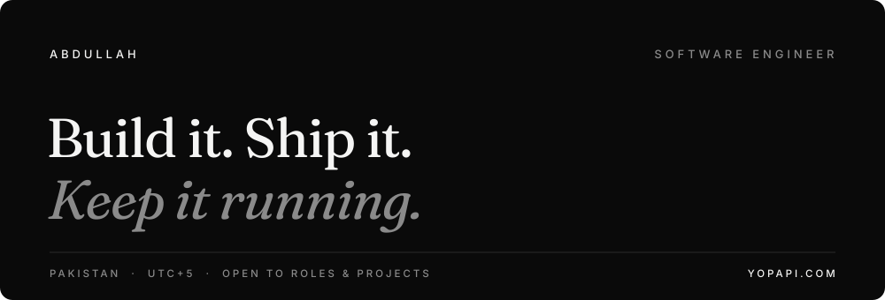

I don't build demos. I build products people pay for, and I stay to keep them running.

I was the only engineer on **[yopapi.com](https://yopapi.com)**. Today it has **20 paying customers**.

[Email](mailto:abdullah.compscientist@gmail.com) &nbsp;·&nbsp; [LinkedIn](https://www.linkedin.com/in/abdullah-nov2004) &nbsp;·&nbsp; [yopapi.com](https://yopapi.com) &nbsp;·&nbsp; [Portfolio](https://portfolio.abdullah-compscientist.workers.dev/)

 

### What I've built

| | | |
|---|---|---|
| [**yopapi.com**](https://yopapi.com) | An AI social media team in a box. Designs on-brand posts and publishes them to Instagram and Facebook every week. | **20 paying customers** |
| [**Jobless**](https://abdullahhak.github.io/jobless/) | Every tech job in Pakistan, in one place. Scrapes 42 companies' career pages every day. | **Live · 254 commits** |
| [**Am I Covered?**](https://github.com/AbdullahHAK/DocuMind-AI) | Ask your insurance policy a question. Get the exact clause, checked against the source. | **100% hit@6** |
| [**Fitting Mirror**](https://github.com/AbdullahHAK/smart_virtual_fitting_mirror_system) | Try clothes on without touching them. Real-time body tracking on Android, fully offline. | **On-device** |
| [**Why Do We Fall?**](https://abdullahhak.github.io/batman_story/) | Four Batman films. Four falls. One rise. A scroll-driven story built from scratch. | **Live** |

 

### How I work

**Launch is the beginning, not the end.** I still run yopapi in production. The real work starts when users arrive.

**Trust nothing. Verify everything.** yopapi confirms every post actually went live. Am I Covered? throws out any quote it can't find in the source.

**Let the model write. Let the code count.** In Am I Covered?, the LLM never does math. Tested Python calculates every dollar.

**Know when to quit.** Errors that can't be fixed by retrying fail immediately. Everything else retries, then heals itself.

**One failure shouldn't sink the ship.** Jobless runs each company's scraper on its own. One broken site never takes down the rest.

 

### Where I've worked

**Sole engineer** · yopapi.com for YH Digital LLC, Morocco · 2026 – now 
**Backend intern** · Securiti AI, Islamabad · 2025 
**Automation developer** · Freelance on Fiverr · 2023 – 2025

 

### Right now

Building a WhatsApp AI agent for yopapi customers. 
Waiting on Meta's app review. 
Taking Jobless from 42 companies to 100.

 

### Tools

TypeScript · Python · Go · Kotlin · Next.js · Node.js · FastAPI · PostgreSQL · Prisma · OpenAI · Claude · Docker · Kubernetes · Terraform · AWS · Vercel · Cloudflare · Stripe · n8n

 

---

Open to remote roles and serious projects. **[abdullah.compscientist@gmail.com](mailto:abdullah.compscientist@gmail.com)**
