<a href="https://yopapi.com">
  <picture>
    <source media="(prefers-color-scheme: dark)" srcset="assets/header-dark.svg">
    
  </picture>
</a>

  

<picture>
  <source media="(prefers-color-scheme: dark)" srcset="assets/proof-dark.svg">
  
</picture>

  

<picture>
  <source media="(prefers-color-scheme: dark)" srcset="assets/section-work-dark.svg">
  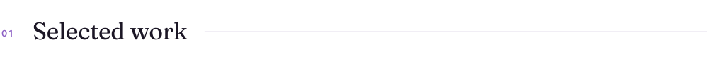
</picture>

<a href="https://yopapi.com">
  <picture>
    <source media="(prefers-color-scheme: dark)" srcset="assets/flagship-dark.svg">
    
  </picture>
</a>

  <a href="https://abdullahhak.github.io/jobless/"><picture><source media="(prefers-color-scheme: dark)" srcset="assets/card-jobless-dark.svg">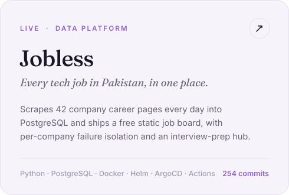</picture></a>
  <a href="https://github.com/AbdullahHAK/DocuMind-AI"><picture><source media="(prefers-color-scheme: dark)" srcset="assets/card-covered-dark.svg">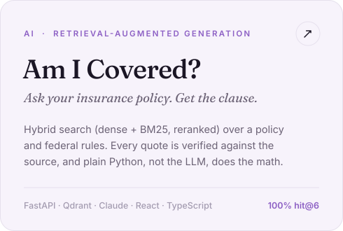</picture></a>

  <a href="https://github.com/AbdullahHAK/smart_virtual_fitting_mirror_system"><picture><source media="(prefers-color-scheme: dark)" srcset="assets/card-mirror-dark.svg">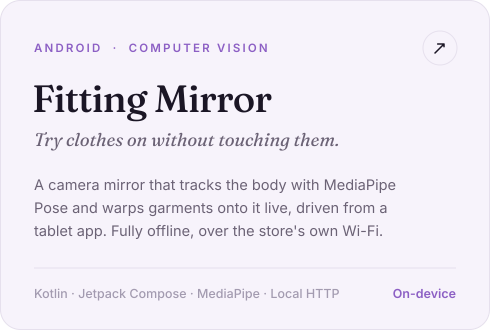</picture></a>
  <a href="https://abdullahhak.github.io/batman_story/"><picture><source media="(prefers-color-scheme: dark)" srcset="assets/card-batman-dark.svg">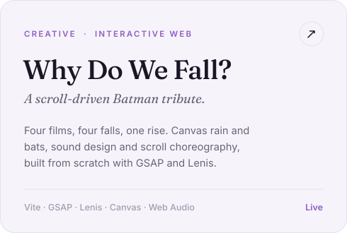</picture></a>

**Also built:**
[DevOps CI/CD pipeline](https://github.com/AbdullahHAK/DevOps-Node-js-CI_CD-pipeline) (Terraform, Ansible and GitHub Actions on AWS) ·
[Notes app](https://github.com/AbdullahHAK/Notes_App_Django_React) (Django REST and React, deployed with managed Postgres) ·
[X Thread to PDF](https://github.com/AbdullahHAK/X_Thread_2_PDF) (Chrome extension) ·
checkout automation for retail clients ([Amazon MX](https://github.com/AbdullahHAK/amazon_product_monitor_and_buy_bot), [Topps](https://github.com/AbdullahHAK/topps-bot))

 

<picture>
  <source media="(prefers-color-scheme: dark)" srcset="assets/section-now-dark.svg">
  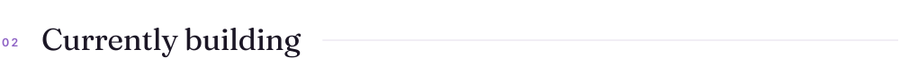
</picture>

<picture>
  <source media="(prefers-color-scheme: dark)" srcset="assets/currently-dark.svg">
  
</picture>

  

<picture>
  <source media="(prefers-color-scheme: dark)" srcset="assets/section-toolkit-dark.svg">
  
</picture>

<picture>
  <source media="(prefers-color-scheme: dark)" srcset="assets/toolkit-dark.svg">
  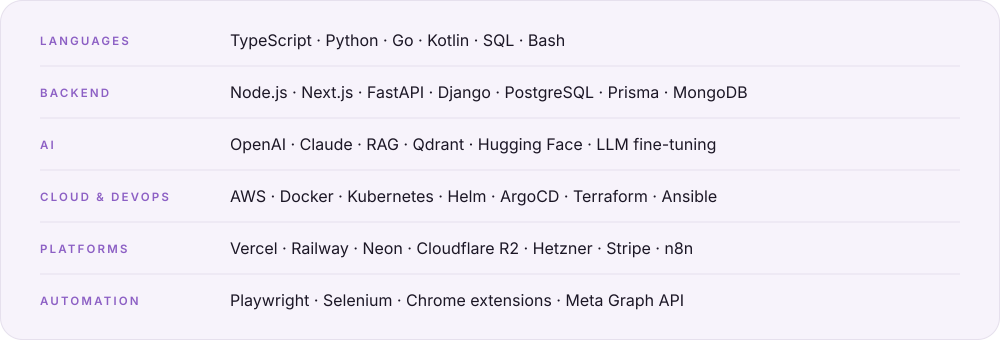
</picture>

  

<picture>
  <source media="(prefers-color-scheme: dark)" srcset="assets/section-activity-dark.svg">
  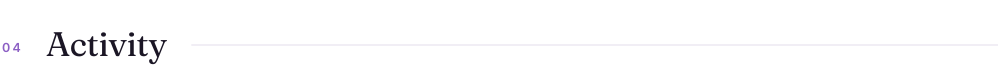
</picture>

<picture>
  <source media="(prefers-color-scheme: dark)" srcset="assets/activity-dark.svg">
  
</picture>

 

<picture>
  <source media="(prefers-color-scheme: dark)" srcset="assets/contact-dark.svg">
  
</picture>

  <a href="mailto:abdullah.compscientist@gmail.com"><picture><source media="(prefers-color-scheme: dark)" srcset="assets/btn-email-dark.svg"></picture></a>
  <a href="https://www.linkedin.com/in/abdullah-nov2004"><picture><source media="(prefers-color-scheme: dark)" srcset="assets/btn-linkedin-dark.svg"></picture></a>
  <a href="https://yopapi.com"><picture><source media="(prefers-color-scheme: dark)" srcset="assets/btn-yopapi-dark.svg">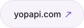</picture></a>
  <a href="https://portfolio.abdullah-compscientist.workers.dev/"><picture><source media="(prefers-color-scheme: dark)" srcset="assets/btn-portfolio-dark.svg">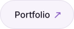</picture></a>

